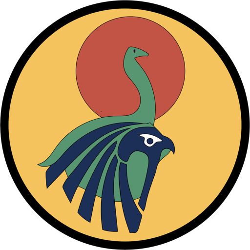
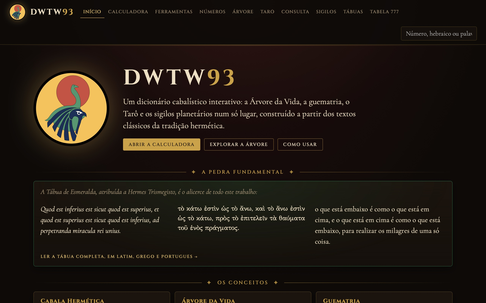
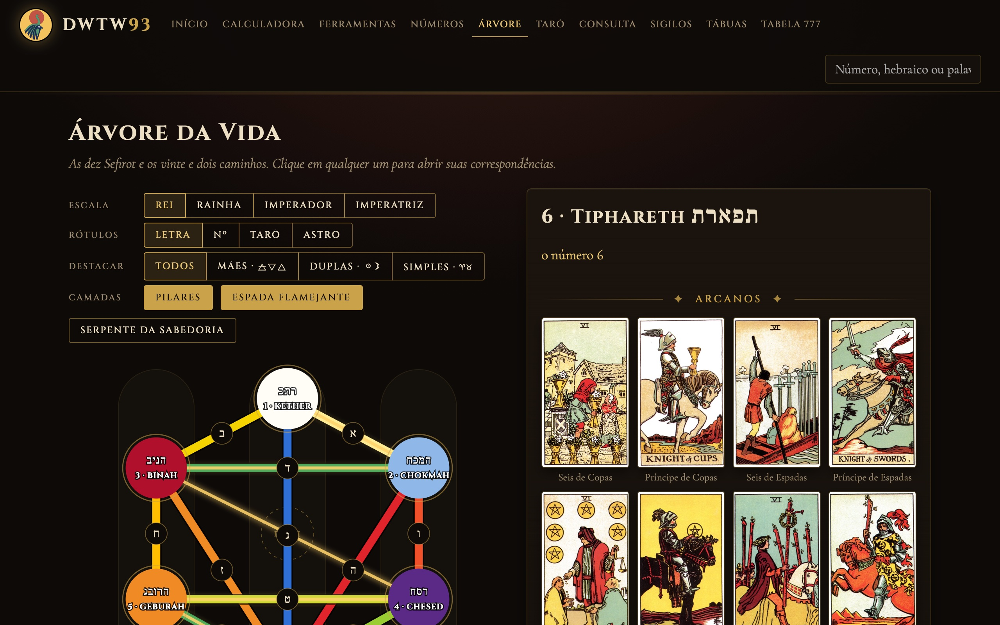
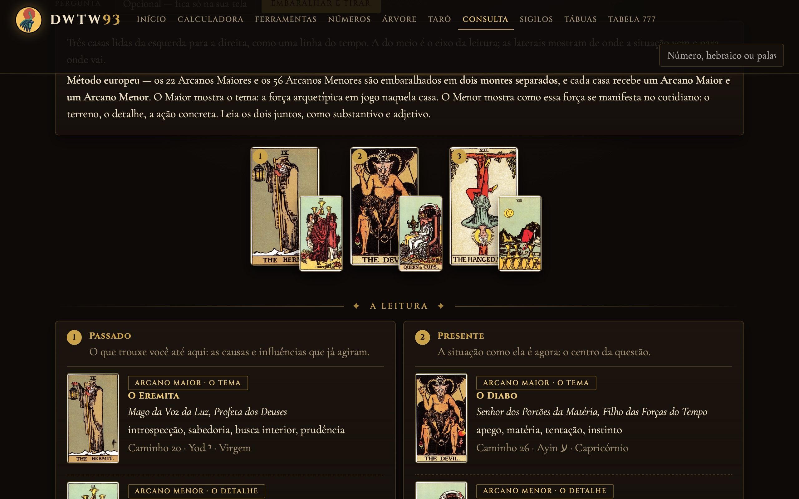
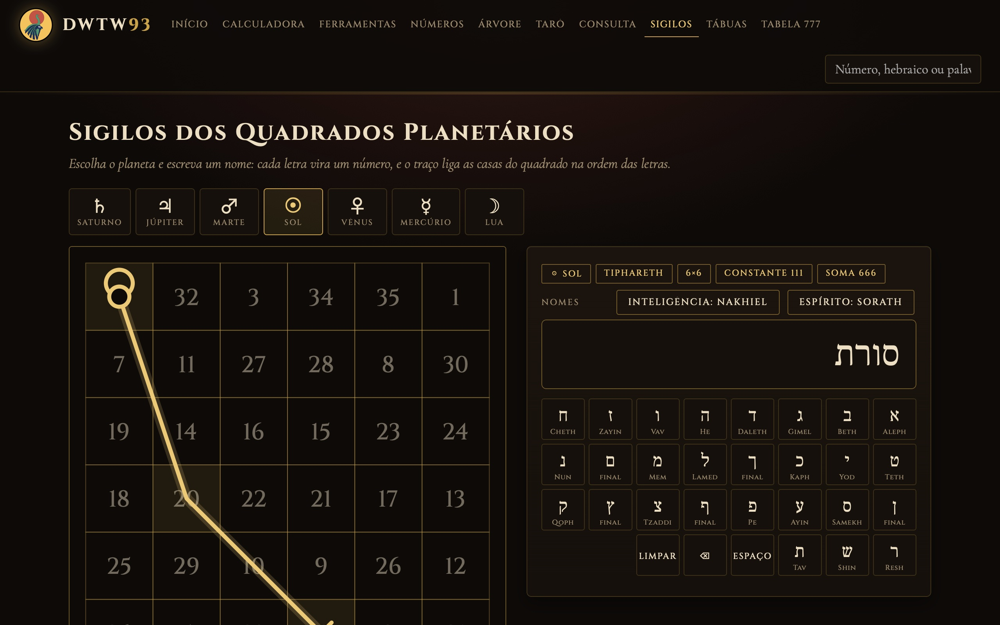
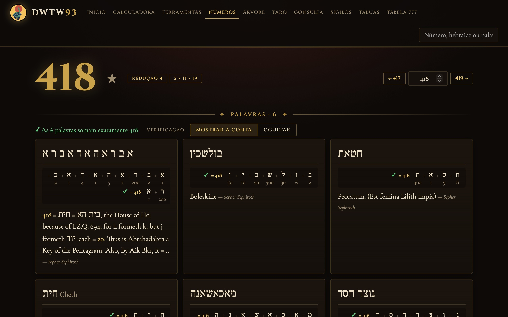
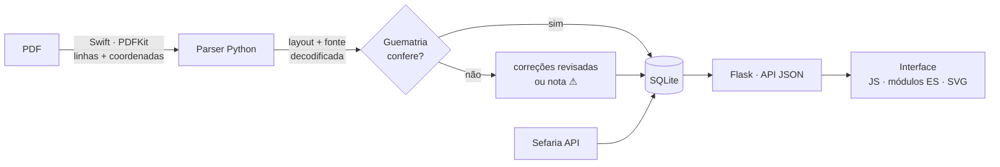

<p align="center">
  
</p>

<h1 align="center">DWTW93</h1>

<p align="center"><b>Um dicionário cabalístico interativo</b>: a Árvore da Vida, a guematria, o Tarô e os sigilos planetários,<br>
construído a partir dos textos clássicos da tradição hermética.</p>

<p align="center"><i>Quod est inferius est sicut quod est superius</i> — a Tábua de Esmeralda, pedra fundamental do projeto.</p>



## O que tem aqui

| | |
|---|---|
| **Calculadora** | Guematria em tempo real (métodos padrão, Gadol, Katan e ordinal), com teclado hebraico na tela |
| **Números** | O dicionário por valor numérico, com a conta de cada palavra verificada letra por letra |
| **Árvore da Vida** | SVG interativo nas 4 escalas de cor do *Liber 777*, com camadas e as cartas de cada caminho |
| **Tarô** | Os 78 arcanos (Rider-Waite-Smith) ligados aos caminhos, às Sefirot e aos decanatos |
| **Consulta** | 1 carta, 3 cartas e Cruz Celta, nos métodos europeu (Maior + Menor por casa) e americano |
| **Sigilos** | Os 7 quadrados mágicos de Agrippa, com o traçado de qualquer nome e exportação em SVG |
| **Ferramentas** | Comparação de palavras, Temurah (Atbash, Albam, Avgad), Aiq Beker e Notariqon |
| **Tábua de Esmeralda** | Em latim, grego e português, lado a lado |
| **Tabela 777** | Até 8 colunas do *Liber 777* lado a lado, traduzidas para o português |

| Árvore da Vida | Consulta ao Tarô |
|---|---|
|  |  |
| **Sigilos** | **Números** |
|  |  |

## Como funciona

O *Liber 777* e o *Sepher Sephiroth* só existiam como PDFs, com tabelas em duas colunas e o hebraico numa fonte
legada (`\yhla` é אלהים, escrito ao contrário com letras latinas). O projeto é, antes de tudo, um pipeline de dados:



- **Validação pelo domínio**: na guematria, cada letra hebraica tem um valor. No *Sepher Sephiroth*, cada palavra está
  sob o número que ela soma — então a soma funciona como *checksum* da extração. 2.327 verbetes entraram validados;
  79 erros do PDF foram corrigidos numa tabela revisável (`cabala/dados/correcoes_sepher.tsv`), cada correção
  conferida de novo pela guematria.
- **Segunda verificação**: a página de cada número refaz a conta no navegador, de forma independente do servidor.
- **Modelo EAV** para as tábuas do 777 (caminho × coluna → valor), com o texto original em inglês guardado ao lado
  da tradução.
- **Testes**: 76 testes com `pytest` (guematria, cifras, quadrados mágicos, banco, API, modo público).

## Rodando localmente

```bash
pip install -r requirements.txt
python3 -m cabala web          # cria o banco e abre http://127.0.0.1:5777
```

Linha de comando: `python3 -m cabala numero 418`, `python3 -m cabala palavra אהבה`, `python3 -m cabala caminho 6`,
`python3 -m cabala --help`.

Testes:

```bash
pip install -r requirements-dev.txt
python3 -m pytest
```

## Deploy

O arquivo `render.yaml` publica o site no [Render](https://render.com) (plano gratuito): **New → Blueprint** e
escolha este repositório. O build gera o banco (`python -m cabala criar`) e o `gunicorn` serve a aplicação.

## Fontes, créditos e licenças

O **código** (Python, SQL, JavaScript, CSS e as ferramentas em `ferramentas/`) é distribuído sob a licença MIT.
Os **dados e imagens** seguem as licenças das suas fontes — a lista completa está na página *Créditos* do site
(`cabala/dados/fontes.tsv`):

- **Aleister Crowley**: *Liber 777* (1909; *777 Revised*, 1955, edição digital da Celephaïs Press) e
  *Sepher Sephiroth* (1912). Domínio público em muitos países.
- **Hermetic Order of the Golden Dawn**: atribuições dos caminhos, decanatos e títulos das cartas (*Book T*).
- **Heinrich Cornelius Agrippa**: os quadrados planetários (*De Occulta Philosophia*, 1533).
- **Sefer Yetzirah**: texto hebraico da edição de Varsóvia (1884), domínio público, via [Sefaria](https://www.sefaria.org/Sefer_Yetzirah).
- **Rider-Waite-Smith** (1909): arte de Pamela Colman Smith e A. E. Waite.
- **Marcelo Del Debbio e Rodrigo A. Grola**: *Hermetic Kabbalah Tarot* (© 2013). Os dados autorais do HKT
  (equivalência em dados, corte ↔ personalidade, geomancia) **não estão neste repositório**: ficam em
  `cabala/dados/privado/`, fora do controle de versão, até a autorização dos autores. Sem essa pasta, o site
  roda em **modo público** e esconde esses dados (também forçável com `DWTW_PUBLICO=1`).

## Quem desenvolveu

**Victor Haruo** — magista, estudante de Sistemas de Informação na FIAP e leitor ávido. O conceito, a curadoria das
fontes e a direção do projeto são dele; o código foi desenvolvido com o **Claude Code** como assistente de programação.
